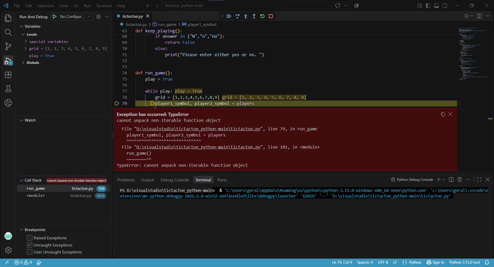
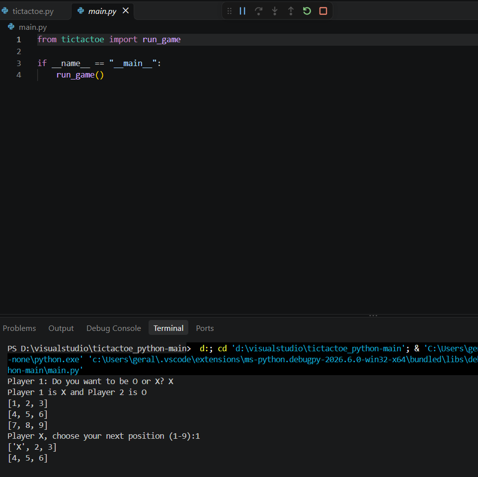
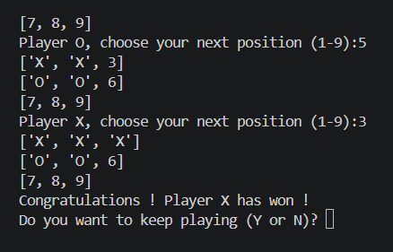
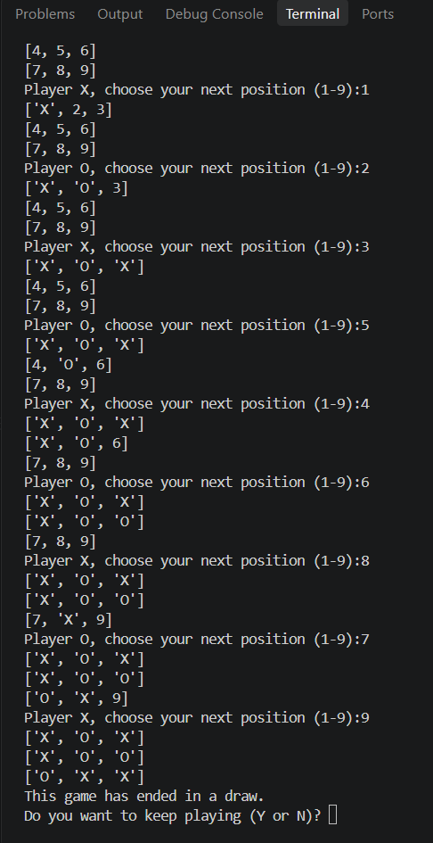
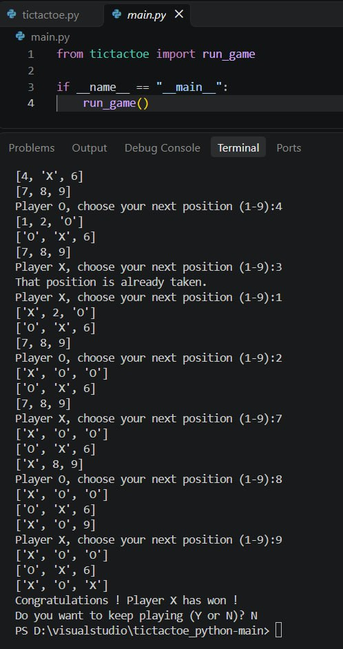

# Bug Fix Report

## Project and Scope

Original project:
https://github.com/ERYXGF/tictactoe_python

The coursework involved running the game, identifying and correcting errors, checking its behavior, and updating the documentation.

The game logic is implemented in `tictactoe.py`.

The `main.py` file imports `run_game` from `tictactoe.py` and calls it. Both launch methods therefore use the same corrected game logic.

## Test Environment

### Manual checks

- Operating system: Windows.
- Python version: 3.15.
- Editor: Visual Studio Code.
- Launch method: Visual Studio Code debugger, started with F5.

### Additional automated checks

- Operating system: Linux.
- Python version: 3.12.14.
- Both `tictactoe.py` and `main.py` were executed with predefined input sequences.

## Launch Commands

Run the project from the folder containing both Python files:

```bash
python main.py
```

On systems where Python 3 is available as `python3`, use:

```bash
python3 main.py
```

The game can also be launched directly:

```bash
python tictactoe.py
```

The first recorded manual execution used the Visual Studio Code debugger to run `tictactoe.py`. The commands above describe equivalent ways to start the submitted game from a terminal.

## Initial Execution

The first recorded run stopped before symbol selection.

- File: `tictactoe.py`.
- Function: `run_game()`.
- Line: 79 in the version shown in the initial screenshot.

Error:

```text
TypeError: cannot unpack non-iterable function object
```

The program attempted to unpack the function object `players` instead of calling the function and receiving its result.

Line numbers below refer to the file at the time each issue was identified. They may differ from the final version.

## Fix 1 — Missing Function Call

### Location

The player symbol assignment in `run_game()`.

### Original code

```python
player1_symbol, player2_symbol = players
```

### Problem

The name `players` refers to the function itself. It does not execute the function.

The assignment expected two values, but received a function object, which caused a TypeError.

### Corrected code

```python
player1_symbol, player2_symbol = players()
```

### Why the correction works

Parentheses call the function. Its returned pair of symbols can then be assigned to the player variables.

After this change, execution reached the symbol selection prompt. Further problems in `players()` were then identified and corrected.

## Fix 2 — Converting a Symbol to an Integer

### Location

The input statement in `players()`, line 15 at the time of discovery.

### Original code

```python
result = int(input("Player 1: Do you want to be O or X"))
```

### Problem

The game asks for a letter, but the code attempts to convert the answer into an integer.

Entering O caused:

```text
ValueError: invalid literal for int() with base 10: 'O'
```

### Corrected code

```python
result = input("Player 1: Do you want to be O or X? ").strip().upper()
```

### Why the correction works

The answer remains a string and can be compared with `"X"` and `"O"`.

The added `strip()` removes surrounding spaces, while `upper()` allows lowercase answers.

## Fix 3 — Missing Return Values

### Location

The valid-answer branches in `players()`.

### Problem

Code inspection showed that the function printed the assigned symbols but did not return them or exit the selection loop after a valid answer.

The calling code required a pair of symbols.

### Corrected function

```python
def players():
    while True:
        result = input("Player 1: Do you want to be O or X? ").strip().upper()

        if result == "X":
            print("Player 1 is X and Player 2 is O")
            return "X", "O"
        elif result == "O":
            print("Player 1 is O and Player 2 is X")
            return "O", "X"
        else:
            print("Please choose either X or O")
```

### Why the correction works

Each valid choice returns two symbols and exits the function.

An invalid answer produces an explanatory message and repeats the prompt.

The returned values can be unpacked by `run_game()`.

## Fix 4 — Boolean Value Instead of a Player Symbol

### Location

The turn-switching statement in `run_game()`, line 98 at the time of correction.

### Original code

```python
current_symbol = player2_symbol if current_symbol == player1_symbol else current_symbol == player1_symbol
```

### Problem

The expression after `else` performs a comparison. It returns `True` or `False` instead of a player symbol.

During a recorded game, the prompt displayed `Player False`, and `False` was placed on the board.

### Corrected code

```python
current_symbol = player2_symbol if current_symbol == player1_symbol else player1_symbol
```

### Why the correction works

If the current symbol belongs to Player 1, the expression selects Player 2's symbol. Otherwise, it selects Player 1's symbol.

Turns therefore alternate between X and O.

## Verification After Corrections

### Manual evidence

The screenshots record:

- The initial TypeError in `tictactoe.py`.
- Successful startup through `main.py` after corrections.
- A completed game with a winning X combination.
- A completed game ending in a draw.
- Exit to PowerShell after entering N.

The recorded winning sequence was:

```text
1, 4, 2, 5, 3
```

X occupied cells 1, 2, and 3, and the game displayed:

```text
Congratulations ! Player X has won !
Do you want to keep playing (Y or N)?
```

The recorded draw sequence was:

```text
1, 2, 3, 5, 4, 6, 8, 7, 9
```

The game displayed:

```text
This game has ended in a draw.
```

### Automated verification of the submitted code

Ten input scenarios were run through each entry point, giving 20 successful end-to-end checks.

The scenarios covered:

1. A horizontal victory for X.
2. Selection of O as Player 1's symbol and a victory for O.
3. A victory for O as the second player.
4. A vertical victory.
5. A victory on the main diagonal.
6. A victory on the other diagonal.
7. A draw when Player 1 selects X.
8. A draw when Player 1 selects O.
9. Invalid input, out-of-range moves, occupied cells, and an invalid replay answer.
10. Restarting with a reset board, selecting another symbol, completing another round, and exiting.

All eight winning combinations were also checked separately for both X and O.

### Results

| Check | Result |
|---|---|
| Startup through `tictactoe.py` | Passed |
| Startup through `main.py` | Passed |
| Selection of X and O | Passed |
| Lowercase symbol selection | Passed |
| Alternating turns | Passed |
| Updating the board | Passed |
| Rejecting non-numeric moves | Passed |
| Rejecting out-of-range moves | Passed |
| Rejecting occupied cells | Passed |
| Detecting row, column, and diagonal victories | Passed |
| Detecting a draw | Passed |
| Starting a new game with a reset board | Passed |
| Exiting after a completed game | Passed |

The automated results apply to the Linux environment listed above. The screenshots document the separate manual checks on Windows.

## Screenshot Evidence

### Initial execution error in tictactoe.py

The initial run stopped because the players function was referenced without being called.



### Successful startup through main.py after corrections

The entry point imports the corrected game function. The screenshot shows successful symbol selection and the beginning of a game.



### Working game and victory detection

The game detects the winning X combination in the top row and displays the replay prompt.



### Draw detection

The board is full without a winning combination, and the game announces a draw.



### Exiting the game

Entering N at the replay prompt ends the program and returns control to PowerShell.



## Relationship Between main.py and tictactoe.py

The `main.py` entry point contains:

```python
from tictactoe import run_game

if __name__ == "__main__":
    run_game()
```

Its successful manual launch was checked after correcting `tictactoe.py`.

No separate game implementation exists in `main.py`: it calls the same `run_game()` function that can be started directly from `tictactoe.py`.

The successful launch after corrections does not demonstrate that the original, uncorrected project worked.

## Conclusion

The identified errors were corrected, and the submitted game passed the recorded manual checks and the additional automated scenarios.

Both entry points use the corrected game logic. The updated documentation explains installation, launch commands, game rules, and common problems.
